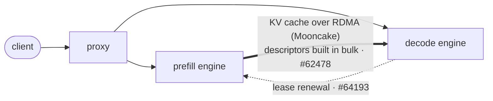

## Junjie Chen

`Hunan University · Changsha`

I work on the plumbing of disaggregated LLM serving: how KV cache leaves one GPU and lands on another over RDMA, without wasting time or bytes on the way.

> I like changes that come with a reproducer and a number.

### Where my changes sit

### Upstream work

| Project | Change | Status |
|---|---|---|
| **vLLM** | [#64193](https://github.com/vllm-project/vllm/pull/64193) The decoder renews the prefiller's KV lease. A crashed decoder's KV is freed in ~80 s instead of 480 s, and requests queued on a busy decoder keep their KV. |  |
| **vLLM** | [#62478](https://github.com/vllm-project/vllm/pull/62478) Mooncake transfer descriptors are built with NumPy, once per KV group. A fragmented call drops from 12.8 ms to 0.77 ms. |  |

### Now

- Turning P/D lease misconfiguration into an explicit error in vLLM's Mooncake connector.
- Research on the RDMA data path for KV cache transfer.

### Toolbox

`C++` `CUDA` `Python` `RDMA verbs` · `vLLM` `SGLang` `Mooncake`
